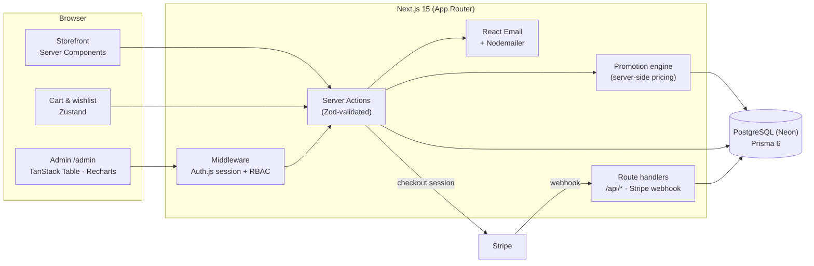

<div align="center">

# Cloths Store — E-Commerce Platform + Admin Dashboard

**A database-driven storefront and a 16-module back office.**
A merchant deploys it, configures everything from `/admin`, and starts selling with no code changes.


[Features](#features) · [Architecture](#architecture) · [Run locally](#run-locally) · [Tests](#tests)

</div>

> **Live demo:** _coming soon_ — run it locally in two minutes with the seeded data below.

---

## Features

**Storefront**
- CMS-driven homepage: promo marquee, hero banner, category grid, lifestyle cards, collection carousels — all managed from admin
- Category pages with filters (price, color, size, material, availability), sorting, pagination and live search suggestions
- Product pages with color-synced galleries, per-variant stock, reviews and related products
- Cart with a **server-side promotion engine**: Nth-item discounts, bundle prices, card-payment discount, free-shipping thresholds, coupons
- 5-step checkout (guest or signed-in) with **Stripe** (test mode) or Cash on Delivery, shipping zones and confirmation emails
- Account area: orders with status timeline, addresses, profile, wishlist with guest → login merge
- SEO: metadata, JSON-LD, sitemap, robots

**Admin — 16 modules**
Dashboard KPIs & charts · Orders (status flow, invoices, packing slips, manual orders) · Products (tabbed editor, variant matrix, CSV import/export) · Categories · Collections · Inventory · Discounts (coupons + promotion builder) · Customers · Reviews moderation · Content CMS · Shipping zones · Payments · Staff & roles (**RBAC**) · Notifications · Reports · Settings (identity, SEO, maintenance mode, audit log)

## Architecture



**Key decisions**
- **Prices are computed on the server only.** The promotion engine runs inside Server Actions, so the cart total the customer sees is the same code path that creates the order.
- **Everything visible is data.** Branding, navigation, banners, pages and footer come from the database, which makes the store reusable for any merchant.
- **Role-based access** (Admin / Manager / Staff) is checked in middleware *and* in every admin action.

## Tech stack

Next.js 15 (App Router, Server Components / Actions) · TypeScript (strict) · Tailwind CSS v4 · Prisma 6 · Auth.js (NextAuth v5) · Stripe · Zustand · Zod · React Email + Nodemailer · Recharts · TanStack Table v8 · Vitest · Playwright

## Run locally

Requirements: Node 20.17+, pnpm and PostgreSQL (local, Docker or Neon).

```bash
git clone https://github.com/sami7q/cloths_store.git && cd cloths_store
pnpm install
cp .env.example .env            # set DATABASE_URL + DATABASE_URL_UNPOOLED to a local or Neon Postgres
pnpm exec prisma migrate deploy
pnpm exec prisma db seed        # 40 products, 25 orders, promotions, coupons…
pnpm dev                        # http://localhost:3000   ·   admin at /admin
```

Seeded logins (local only):

| Role | Email | Password |
|---|---|---|
| Admin | `admin@store.test` | `Admin123!` |
| Manager | `manager@store.test` | `Admin123!` |
| Staff | `staff@store.test` | `Admin123!` |

Stripe and Google sign-in are optional — without keys, card payment renders disabled and Cash on Delivery keeps working.

## Tests

```bash
pnpm test          # unit tests (Vitest): promotion engine rules
pnpm test:e2e      # Playwright: checkout flow, admin product CRUD, order status changes
pnpm lint
```

## Deploying

The schema is Postgres-compatible throughout. On Vercel, set `DATABASE_URL` to a Neon Postgres URL; the `vercel-build` script runs `prisma generate && prisma migrate deploy && next build`.

## Project structure

```text
src/
  app/(storefront)   public store pages
  app/(auth)         sign-in / sign-up
  app/admin          16 admin modules
  app/api            route handlers, Stripe webhook
  server/            server actions and data access (storefront + admin)
  lib/               promotion engine, Stripe payments, utilities
  components/        UI components
  emails/            React Email templates
prisma/              schema, migrations, seed
e2e/                 Playwright specs
```

---

<div align="center">

Built by **Sami Aqeel** · [LinkedIn](https://www.linkedin.com/in/sami-sami-496a33231/) · [GitHub](https://github.com/sami7q) · sami22eng@gmail.com

</div>
